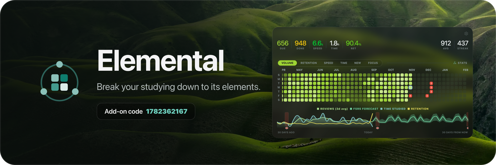
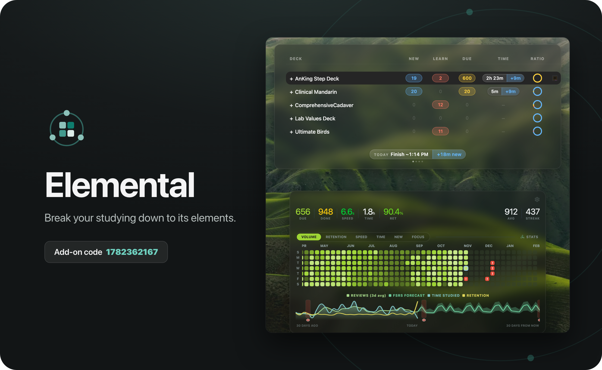

# Elemental

*Break your studying down to its elements.* (Formerly Interactive Heatmap.)

**Install:** in Anki, go to Tools → Add-ons → Get Add-ons and enter code **1782362167**
([AnkiWeb page](https://ankiweb.net/shared/info/1782362167)), or download the `.ankiaddon` in [`releases/`](releases/).

See your studying at a glance. Elemental puts a calendar of your reviews right on Anki's main screen, along with a few simple stats and graphs, so you can tell how you're doing without opening the Stats window.

It works in light and dark mode, and everything is optional. Turn on what you like in **Tools → Elemental Settings**.

## The heatmap

- A calendar of the past months, one square per day, on your deck list and on each deck's overview.
- Switch between views with one click:
  - **Volume**: how many cards you reviewed
  - **Retention**: how many you got right
  - **Speed**: how fast you answered
  - **Time**: how long you studied
  - **New**: how many new cards you learned
  - **Focus**: how steady your answers were (needs Time Left, below)
- Hover over a day to see its numbers. Click a day to see its cards, focus and study sessions, or to add a note or mark an exam date.
- Upcoming days show your forecast, so you can see busy days coming.
- Show every deck, or only the ones you pick.

## Stats and graphs

- A stats bar with cards due, done today, speed, time studied, retention, your daily average and your streak.
- Graphs of reviews, time per card, time studied, retention and the forecast, covering 30 days back and 30 days ahead.
- An optional FSRS forecast that simulates the coming weeks, plus rolling averages and exam markers on the graph.
- Tell the forecast which days you add new cards on (like M, T, Th, F), or let it match your last 4 weeks.
- An optional confidence band around the forecast shows the range your reviews will likely land in, based on how much your own days vary.

## Time Left (optional)

- Shows how long today's cards will take: a Time column in your deck list, today's finish time, and the time on each deck's overview.
- Learns from your own review history and gets better every day.
- **Tools → Time Estimate Accuracy** shows how close it has been.

## Live Stats (optional)

- A small box in a corner of the review screen showing your retention and when you'll finish.
- Hover it for the details, including today's **focus score**: how many cards you answered in about your usual time for that card. Cards where you stopped to look something up are left out.
- A soft ring around it after each answer shows whether it was a focused one.

## Make it yours

- **Themes**: 19 color themes for the heatmap, graphs and deck pills. Six of them come with a matching background photo. Each theme has a light and a dark version.
- **Background photo**: a photo behind your main screens. Pick a built-in one, or use your own photos and get a new one every day.
- **Deck list**: a cleaner look with count pills and an activity ring. Filtered decks get their own color.
- Square, rounded or circle cells, and control over how faint quiet days look.

## A nicer card browser

- Clozes are colored by number, so you can read them at a glance.
- Suspended, buried, marked and flagged cards each get their own tint and symbol.
- Shorter tags if you want them (show just the last part, or `A › B › C`).
- Choose your row spacing, a matching theme for the note editor, and right-click any tag in the sidebar to give it a color.

## AnKing card styling (optional)

If you use the AnKing deck, **Settings → AnKing Cards** can add two styling changes to your AnKingOverhaul cards:

- **Clean Reading Theme**: a calmer layout, with the Extra field under the answer and clozes shown as soft pills.
- **Beautify Text Dashes**: lines starting with "- " become bullet points.

You can preview both on one of your own cards before applying. A backup is saved first, Remove takes them out again, and AnKing updates keep them. The page only shows up if you have AnKing cards.

## Settings

Everything lives in one window with a sidebar and a search box. Type what you're looking for and it takes you there. Most pages show a live preview, so you can see a change before you save it.

## Privacy

Everything runs on your own computer. The add-on reads your review history to draw the heatmap. It doesn't change your cards and doesn't send your data anywhere. The only card change is AnKing styling, and only when you click Apply.

The only thing that ever leaves your computer is feedback you choose to send from **Settings → Feedback**. Before you send, you can see exactly what's included: your message, and if you leave the box ticked, your Anki and add-on versions and your list of add-ons. Never your cards or reviews.

## Feedback

Found a bug or have an idea? Send it from **Settings → Feedback**, no account needed. I read every message.

## What's new in 1.9.5

- Heatmap improvements: more heatmap display settings, like separating months, and you can scroll back through more of your history.
- Bug fixes and improvements.

In 1.9.4:

- Adds a pomodoro timer to your daily reviews, in Live Stats. Turn it on in **Settings → Live Stats**.

In 1.9.3:

- New name: Interactive Heatmap is now Elemental.
- Click STATS next to the heatmap's views to see the last month, three months, year or all time: your reviews each week, when you study, your topics and the cards you forget most.
- Fixed error windows saying "no cards to simulate" or "database is locked".

In 1.9.2:

- Click any day on the heatmap to see it up close: your focus, when you studied, your weakest topics and every card you answered.
- The forecast now lines up with your actual reviews, and today shows what you have left.
- You can tell the forecast which days you add new cards, or match your last 4 weeks.
- You can turn on a confidence band around the forecast.
- The New, Learn and Due counts are brighter in every theme.
- Fixed a "database is locked" error on Windows. Time Left now works on Windows too.

In 1.9.1:

- 19 themes, six of them with a matching background photo
- A focus score in Live Stats, and a FOCUS view on the heatmap
- A new settings window with search and live previews
- AnKing card styling, with a preview and one-click removal
- Background photos: a built-in one, or your own with a new one each day
- Views switch instantly, and Anki no longer freezes after it starts
- Browser fixes on Windows, filtered deck colors, and easier-to-read clozes in light mode

See every past update in **Settings → Version History**.

---

*Built-in background photos are from [Unsplash](https://unsplash.com) (Unsplash License). Photographer credits are in the add-on's `builtin_backgrounds/CREDITS.txt`.*

## In this repo

- `addon/`: the add-on source, exactly as it ships in the package
- `releases/`: the installable `.ankiaddon` file
- `promo/`: posters and banners (`promo/Rounded/` has white rounded corners for the web), plus the scripts that made them in `promo/source/`

## License

The code is under the [MIT License](LICENSE). The background photos in `addon/builtin_backgrounds/` are by their photographers and used under the [Unsplash License](https://unsplash.com/license); see [CREDITS.txt](addon/builtin_backgrounds/CREDITS.txt).
